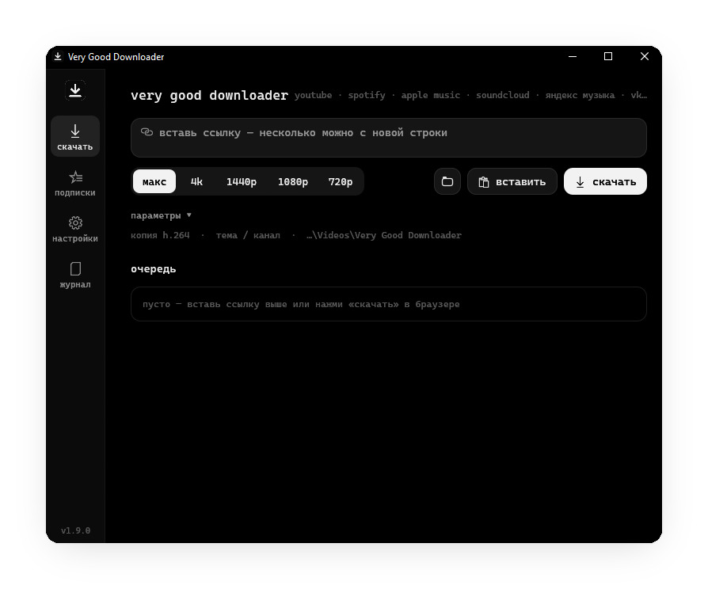
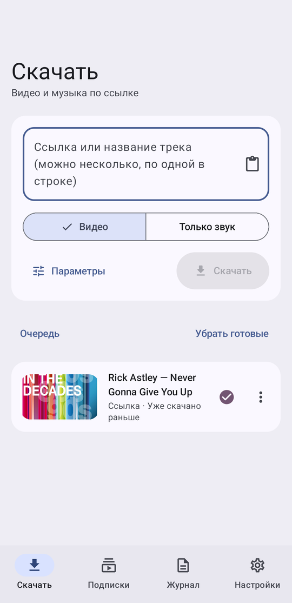
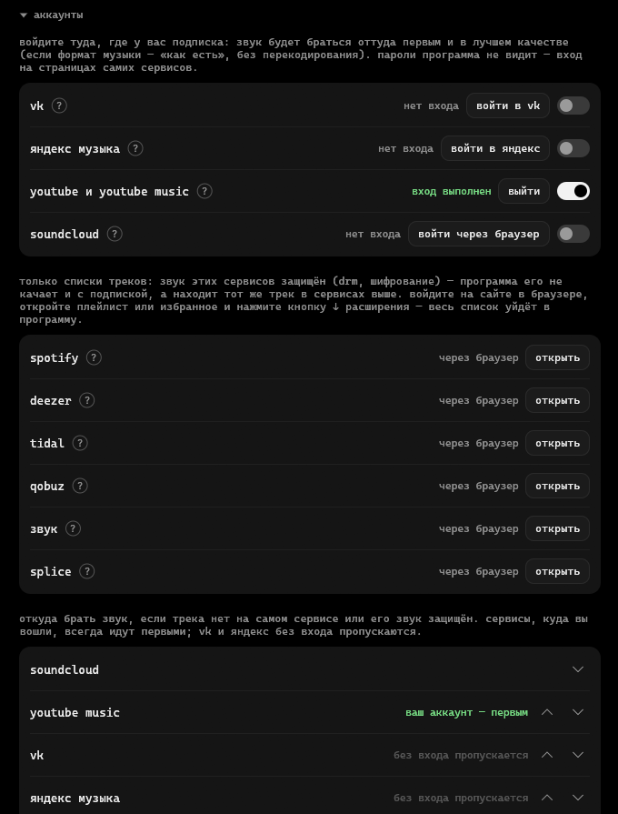
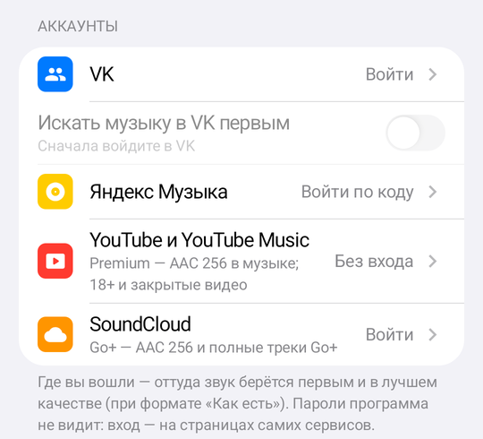
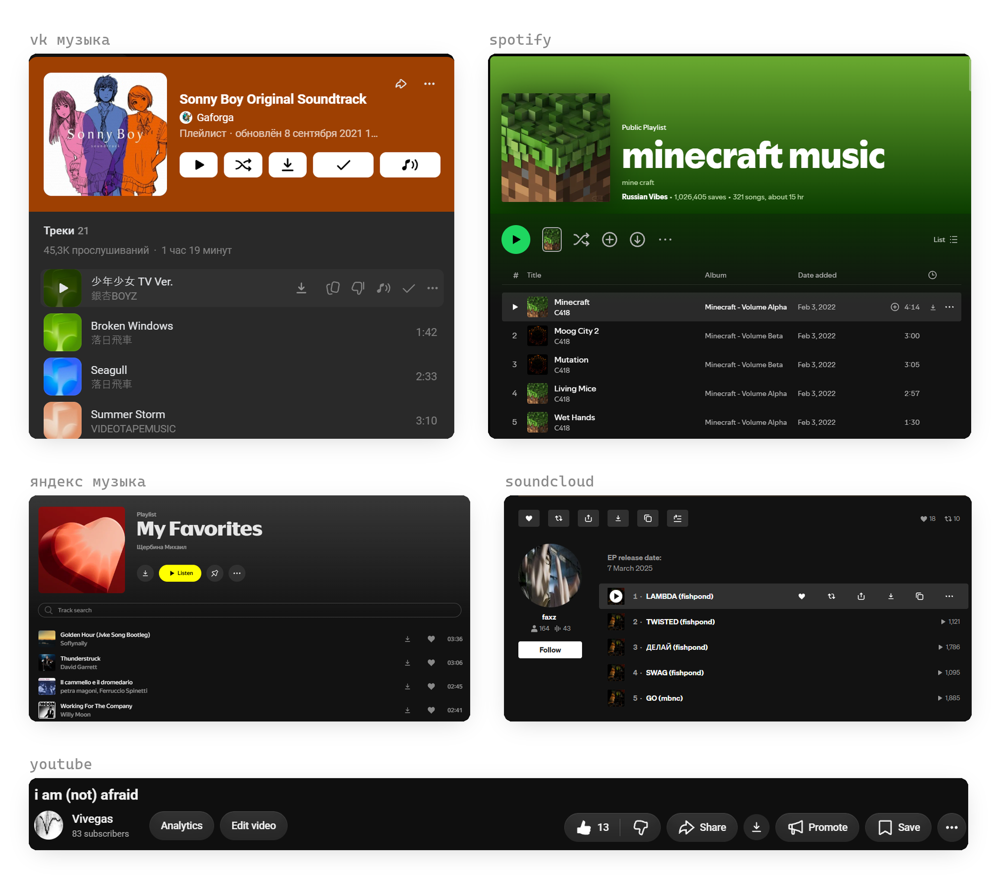
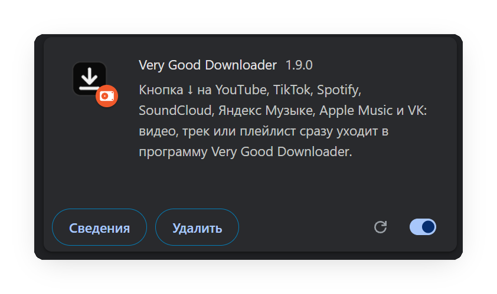

<h1 align="center">Very Good Downloader</h1>

<p align="center">
  Видео и музыка с YouTube, VK, Spotify, Apple Music, Яндекс Музыки, SoundCloud, Deezer, Tidal и других сайтов —<br>
  в максимальном качестве, с тегами и обложками, разложенные по папкам.<br>
  <b>Windows и Android</b> · кнопка ↓ прямо на сайтах · без рекламы и регистрации.
</p>

<p align="center">
  <a href="https://github.com/Vivegass/very-good-downloader/releases/latest"><b>⬇ Скачать последнюю версию</b></a>
</p>

<p align="center">
  
  &nbsp;
  
</p>

## Коротко

- **Вставьте ссылку или просто название** — программа сама поймёт, что это: видео, плейлист, канал, альбом или дискография. По названию покажет, что нашлось: исполнителей, альбомы и треки с обложками — выберите нужное.
- **Видео** — до 4K и 60 fps, оригинал без перекодирования или сразу копия для монтажа (H.264 / ProRes).
- **Музыка** — с тегами, квадратной обложкой, текстом песни и плейлистом `.m3u8`. Если трека нет там, откуда вы его просили, программа найдёт ту же запись в другом месте и **сверит по звуку**.
- **Аккаунты** — войдите туда, где у вас подписка: звук будет браться оттуда первым и в лучшем качестве (FLAC с Яндекса, AAC 256 с YouTube Music Premium и SoundCloud Go+).
- **Расширение для браузера** — кнопка ↓ на YouTube, VK, Spotify, Яндекс Музыке, SoundCloud, Apple Music, Deezer, Tidal, Qobuz, Звуке и TikTok.
- **Одна версия на ПК и телефоне**: общий релиз, общие настройки и одинаковое поведение.

## Что скачать

| Где | Файл на странице [релизов](https://github.com/Vivegass/very-good-downloader/releases/latest) |
|---|---|
| Windows 10 / 11 | `VeryGoodDownloader-Setup-<версия>.exe` — установщик, или `…-portable.zip` — без установки |
| Android 8 и новее | `VeryGoodDownloader-android-<версия>-arm64.apk` |
| Firefox | `extension-firefox.xpi` — расширение одной кнопкой «Добавить» |
| Chrome, Edge, Яндекс.Браузер | расширение лежит в папке программы — см. [Установка](#установка) |

yt-dlp, ffmpeg и всё остальное уже внутри. Права администратора не нужны. Обновления программа предлагает сама: файл берётся отсюда, с GitHub, и сверяется по SHA-256.

## Видео

- **YouTube** — видео, Shorts, плейлисты и каналы целиком. Качество — максимум или ограничение: 4K, 1440p, 1080p, 720p и предел fps.
- **Другие сайты** — TikTok, VK Видео, Rutube, Pinterest и всё, что умеет [yt-dlp](https://github.com/yt-dlp/yt-dlp).
- **Оригинал без перекодирования** (MKV: VP9 / AV1 / Opus — как отдаёт YouTube).
- **Копия для монтажа** — H.264 MP4 или ProRes 422 HQ, постоянная частота кадров, HDR → SDR. Открывается в After Effects и Premiere. Можно сохранять **сразу в этом формате**, без MKV.
- **Субтитры** `.srt` (по умолчанию ru и en) и **обложка** `.jpg` рядом с видео.
- **Раскладка по папкам «Категория / Канал»**: категория — по названию, тегам и плейлисту (Эдиты, Туториалы, Моушн и VFX, Игры, Музыка, Кино; слова настраиваются). Похожие ники одного автора попадают в одну папку. «Разложить папку» наводит порядок в уже скачанном, сначала показав план.
- **Фрагмент** «с … до …», **только звук**, **SponsorBlock**, **разбивка по главам**.
- **Микс или альбом одним видео → отдельные треки** — по главам, таймкодам в описании или в закреплённом комментарии.

## Музыка

- **Spotify, Apple Music, Яндекс Музыка, VK, YouTube Music, SoundCloud, Deezer, Tidal** — треки, альбомы, плейлисты.
- **Дискография исполнителя** — по названию или ссылке на исполнителя открывается список релизов: альбомы, EP, синглы, сборники, концертные. Отметьте нужное (повторы вроде Deluxe и Remaster снимаются сами), скачайте «популярное» или подпишитесь на новые релизы. Папки — «год - альбом».
- **Qobuz, Звук, Amazon Music, Beatport, Shazam и другие** — название трека берётся через song.link (нужен ключ в настройках музыки) или кнопкой расширения на странице. Звук программа находит сама.
- **Поиск по названию**: начните печатать — под полем появятся исполнители, альбомы и треки из каталога. Ctrl+Enter (на телефоне — «Скачать») сразу берёт лучший трек; несколько строк `исполнитель — название` — целый список.
- **Звук с самого сервиса**, где это возможно: VK (mp3 320), Яндекс Музыка (FLAC со входом), SoundCloud, YouTube Music.
- **Замена недоступным трекам**: у Spotify и Apple Music звук закрыт, а на VK или SoundCloud трек бывает заблокирован. Тогда программа ищет ту же запись в ваших аккаунтах, на YouTube Music, SoundCloud, Audius и YouTube. Запись проверяется по ISRC и длительности и **сравнивается по звуку** с 30-секундным отрывком оригинала. Каверы, ремиксы и sped up не проходят. Найденное в другом месте можно класть в отдельную папку.
- Файлы `Музыка\<плейлист>\01 - Исполнитель - Название` с **тегами, квадратной обложкой** и `.m3u8`. Формат — «как есть» (без перекодирования), mp3 320, m4a или flac.
- **Тексты песен** (LRCLIB) — в тег файла и `.lrc` с таймингом рядом.
- **Splice** — по ссылке на сэмпл видно название, BPM и тональность. Сами сэмплы выдаёт только приложение Splice.
- Уже скачанное не качается второй раз — ни с того же сервиса, ни с другого. Рядом лежит `_откуда скачано.txt`: какой файл, откуда и по какой ссылке.

## Аккаунты

**Настройки → аккаунты.** Войдите туда, где у вас подписка. Эти сервисы становятся первыми в очереди поиска, и при формате «как есть» звук берётся в их лучшем качестве.

<p align="center">
  
  &nbsp;
  
</p>

## Расширение для браузера

Кнопка ↓ прямо на странице: видео, трек или плейлист сразу уходит в программу. Если программа закрыта, расширение запустит её само.

<p align="center">
  
</p>

- **YouTube, TikTok, VK, Spotify, SoundCloud, Яндекс Музыка, Apple Music** — кнопка рядом с «Нравится» / «Поделиться», у каждого трека в списке и в плеере.
- **Spotify и VK** — плейлист собирается со страницы целиком, любой длины.
- **Deezer, Tidal, Qobuz, Звук, Beatport, Amazon Music** — кнопка «↓ список в VGD» внизу слева. Она отправляет ваш плейлист или избранное целиком.
- На любом другом сайте — значок расширения или «Скачать в Very Good Downloader» в меню правой кнопки.

## Кнопки в приложении Spotify

Настройки → «приложение spotify» → «установить в spotify». В Spotify для Windows появится «Скачать в Very Good Downloader»: в меню правой кнопки (трек, несколько треков, плейлист, альбом, исполнитель, «Любимые треки»), рядом с Play в шапке плейлиста и в плеере. Работает через [Spicetify](https://spicetify.app) (совместим со SpotX); программа сама его поставит. После обновления Spotify кнопки возвращаются сами. Spotify из Microsoft Store не поддерживается.

## На Android

- **«Поделиться» → «VGD: скачать»** из YouTube, Spotify, VK, браузера — из любого приложения.
- Плитка в шторке «скачать из буфера» и ярлыки на значке приложения.
- Загрузки идут в фоне, даже если приложение закрыто. Об окончании скажет уведомление.
- **Подписки** проверяются сами по расписанию.
- Оформление под ваш телефон: стили Material You, One UI, HyperOS, HarmonyOS и iOS, цвета из обоев и темы с ПК.
- Файлы ложатся в `Download/Very Good Downloader` и сразу видны в галерее и плеерах.

## Ещё

- **Очередь**: пауза и продолжение с того же места, порядок стрелками, небольшая музыка качается параллельно с длинной загрузкой.
- **Пресеты** («Эдиты 1080/24», «Музыка FLAC»…) и свои настройки для отдельной ссылки.
- **Подписки** на каналы и плейлисты: качается только новое, можно ограничить «не старше N дней» или «только звук». `vgd sync` — для Планировщика заданий Windows.
- **Поиск по настройкам**, **буфер обмена** («скачать скопированную ссылку?»), **уведомления**, **трей** и автозапуск.
- Если VPN или прокси отвалился, программа понятно говорит об этом и ждёт. Временные отказы сайтов повторяет сама.
- **Темы оформления** и свои темы из файла.
- Свежий yt-dlp — одной кнопкой. **Консоль** `vgd.exe` умеет всё то же из командной строки (`vgd --help`).

## Установка

**Windows.** Скачайте установщик `VeryGoodDownloader-Setup-<версия>.exe` (или `portable.zip`) со страницы [релизов](https://github.com/Vivegass/very-good-downloader/releases/latest). Установщик не подписан, поэтому SmartScreen может предупредить: «Подробнее» → «Выполнить в любом случае».

**Расширение.** Установщик в конце предложит его поставить. Позже это можно сделать в настройках → «установить в браузер».
- **Firefox** — одна кнопка «Добавить».
- **Chrome, Edge, Яндекс.Браузер** — программа откроет страницу расширений и папку `extension`. Включите «Режим разработчика» и перетащите папку на страницу. После обновления программы нажмите ↻ у расширения.

<p align="center">
  
</p>

**Android.** Скачайте `VeryGoodDownloader-android-<версия>-arm64.apk` на телефон, откройте его и разрешите установку из этого источника. Дальше приложение обновляется само.

## Частые вопросы

**YouTube перестал качать.** YouTube регулярно ломает старые версии yt-dlp. Нажмите «обновить yt-dlp» в настройках: на ПК — «доступ и обновления», на Android — «yt-dlp».

**Видео 18+ или закрытое.** На ПК — настройки → «куки для 18+ и закрытых» (лучше Firefox или файл `cookies.txt`) или вход в YouTube во вкладке «Аккаунты». На Android — «Аккаунты → YouTube».

**Трек скачался не оттуда.** Откуда взят каждый трек, видно в журнале и в `_откуда скачано.txt`. Чтобы брать звук из своего сервиса первым, войдите в него и поднимите стрелками в «Аккаунты → откуда брать звук».

**Где настройки.** Windows — `%APPDATA%\VeryGoodDownloader\settings.json`. Android — внутри приложения.

## Для разработчиков

Ядро на Rust общее для обеих платформ. Окно Windows сделано на egui, приложение Android — на Kotlin и Jetpack Compose (UniFFI). Скачивают yt-dlp и ffmpeg.

```powershell
powershell -ExecutionPolicy Bypass -File rust\build.ps1
```

Собирает установщик, portable-архив и (если есть ключ подписи) APK в `release\`. Тесты — `cargo test --lib` в папке `rust`.

- Устройство программы, обновления и история версий — [rust/README.md](rust/README.md)
- Сборка и устройство Android-версии — [android/README.md](android/README.md)
