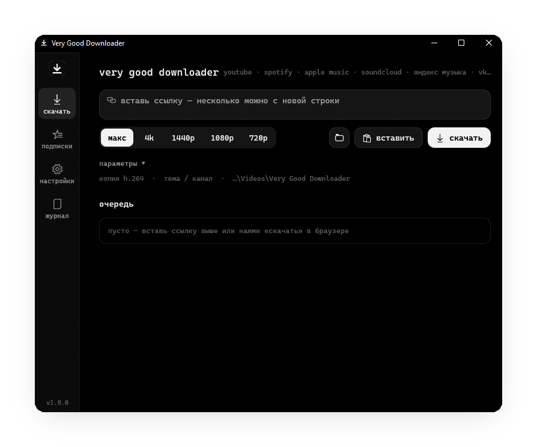
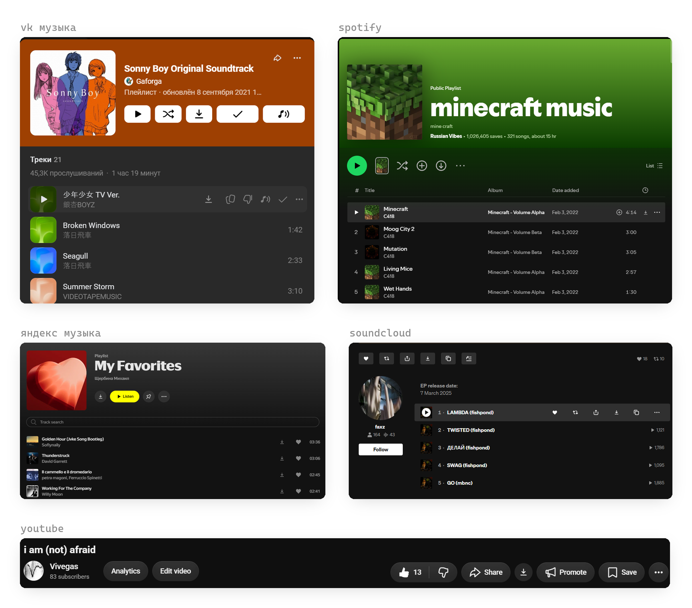
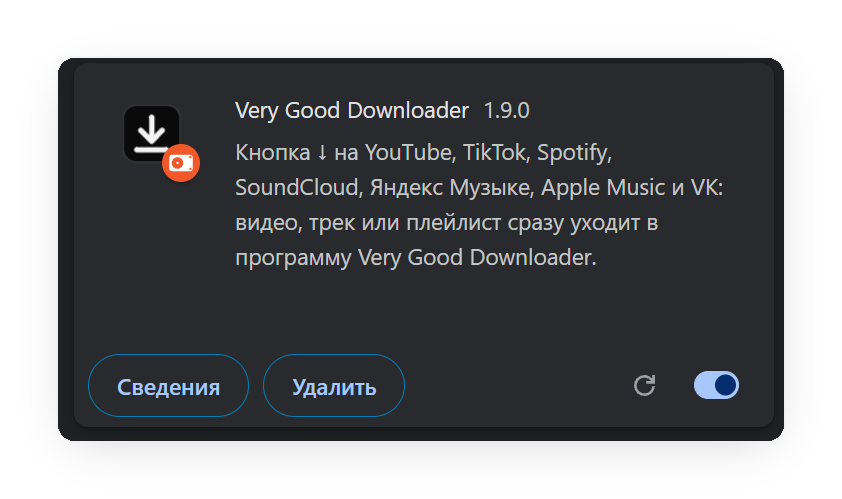

<h1 align="center">Very Good Downloader</h1>

<p align="center">
  Видео и музыка с YouTube, VK, Spotify, Apple Music, SoundCloud, Яндекс Музыки и других сайтов —<br>
  в максимальном качестве, с тегами и обложками, разложенные по папкам. Для Windows.
</p>

<p align="center">
  <a href="https://github.com/Vivegass/very-good-downloader/releases/latest"><b>Скачать последнюю версию</b></a>
</p>

<p align="center">
  
</p>

## Видео

- **YouTube** — отдельные видео, плейлисты и каналы целиком. Качество — максимум или ограничение: 4K, 1440p, 1080p, 720p и предел fps.
- **Другие сайты** — TikTok, VK Видео, Rutube, Pinterest и всё, что умеет [yt-dlp](https://github.com/yt-dlp/yt-dlp).
- **Оригинал без перекодирования** (MKV: VP9 / AV1 / Opus — как отдаёт YouTube).
- **Копия для монтажа** — H.264 MP4 или ProRes 422 HQ, постоянная частота кадров, HDR переводится в SDR. Открывается в After Effects и Premiere.
- **Субтитры** (`.srt`, по умолчанию ru и en, автосубтитры — на языке оригинала) и **обложка** `.jpg` рядом с видео.
- **Раскладка по папкам «Тема / Канал»**: тема определяется по названию, тегам и плейлисту (Эдиты, Туториалы, Моушн и VFX, Игры, Музыка, Кино — список правится), похожие ники одного автора попадают в одну папку. Кнопка «Разложить папку» наводит порядок в уже скачанном — сначала показывает план.
- **Фрагмент** «с … до …», **только звук**, **SponsorBlock** (вырезать рекламные вставки), **разбивка по главам**.
- Закрытые и 18+ видео — через куки браузера (Firefox) или `cookies.txt`.

## Музыка

- **Spotify, Apple Music, Яндекс Музыка, VK, Deezer, SoundCloud, YouTube Music** — треки, альбомы, плейлисты.
- **VK — звук прямо из VK**: плейлист забирается целиком через ваш вход в VK, mp3 320.
- SoundCloud и YouTube Music — звук с самого сервиса. Для Spotify, Apple Music и Яндекса программа находит ту же запись на YouTube Music → SoundCloud → Audius → YouTube и проверяет её по ISRC и длительности (без каверов, live и ускоренных версий). Так же спасаются треки, заблокированные на своём сервисе.
- **Дискография исполнителя** — альбомы, EP и синглы по папкам «год - альбом».
- Файлы `Музыка\<плейлист>\01 - Исполнитель - Название` с **тегами, квадратной обложкой** и плейлистом `.m3u8`; формат — как есть, mp3 320, m4a или flac.
- **Тексты песен** (LRCLIB) — в тег файла и `.lrc` с таймингом рядом.
- Уже скачанное не качается повторно — ни с того же, ни с другого сервиса. 4 трека загружаются одновременно.

## Расширение для браузера

Кнопка ↓ прямо на страницах сайтов — видео, трек или плейлист сразу уходит в программу. Если программа закрыта, расширение само её запустит.

<p align="center">
  
</p>

На любом другом сайте — значок расширения или пункт «Скачать в Very Good Downloader» в меню правой кнопки.

## Ещё

- **Подписки** на каналы и плейлисты: программа сама качает только новое (можно ограничить «не старше N дней» или «только звук»). `vgd sync` — для Планировщика заданий Windows.
- Следит за **буфером обмена**, показывает **уведомление** по окончании, сворачивается **в трей** и продолжает загрузку.
- Если VPN или прокси отвалился — говорит об этом понятно и ждёт, а не копит ошибки; временные отказы сайта повторяет.
- Свежий yt-dlp — одной кнопкой в настройках.
- **Консоль** `vgd.exe` — всё то же из командной строки, `vgd --help`.

## Установка

1. Скачайте со страницы [Releases](https://github.com/Vivegass/very-good-downloader/releases/latest) установщик `VeryGoodDownloader-Setup-<версия>.exe` (или `portable.zip` — без установки). yt-dlp, ffmpeg и deno уже внутри, права администратора не нужны.
2. Расширение: откройте `chrome://extensions` (Chrome, Edge, Яндекс.Браузер), включите «Режим разработчика», нажмите «Загрузить распакованное» и выберите папку `extension` рядом с программой.

<p align="center">
  
</p>

Установщик не подписан — Windows SmartScreen может предупредить: «Подробнее» → «Выполнить в любом случае».

## Сборка

Нужны Rust (MSVC) и Visual Studio Build Tools, для установщика — Inno Setup 6.

```powershell
powershell -ExecutionPolicy Bypass -File rust\build.ps1
```

Готовая папка — `rust\dist\VeryGoodDownloader\`, установщик — `release\`. Тесты: `cargo test --lib` в папке `rust`. Устройство программы и история версий — в [rust/README.md](rust/README.md).
